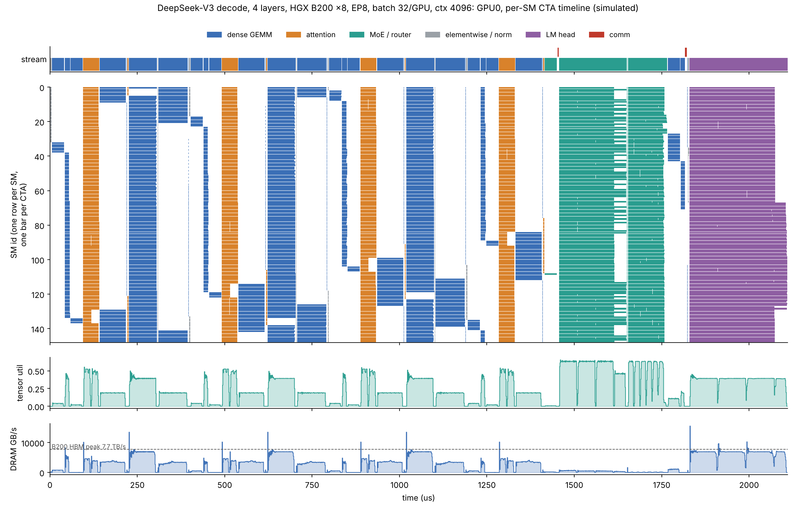
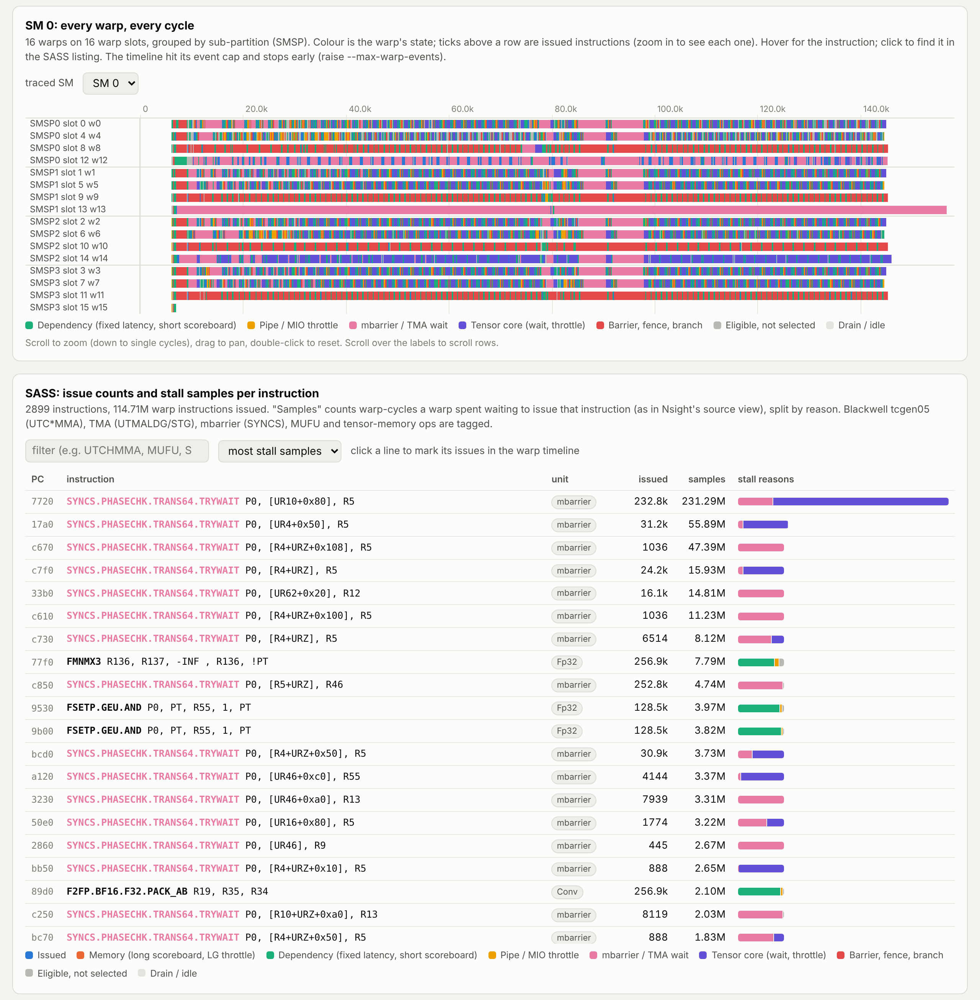
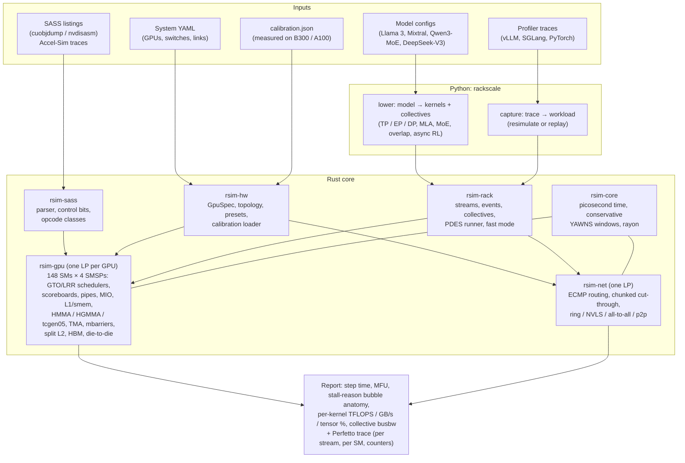

# rackscale

**Cycle-level simulation of a whole GPU rack, from SASS instructions up to NVLink collectives.**

[](https://github.com/AbiralShakya/ChewingOn_RackScaleSimulation/actions/workflows/ci.yml)
[](https://abiralshakya.github.io/ChewingOn_RackScaleSimulation/)
[](LICENSE)


**[Documentation](https://abiralshakya.github.io/ChewingOn_RackScaleSimulation/)** · [Quickstart](#quickstart) · [Tutorials](https://abiralshakya.github.io/ChewingOn_RackScaleSimulation/tutorials/single-kernel/) ·
[Examples](https://abiralshakya.github.io/ChewingOn_RackScaleSimulation/examples/) · [The guide](docs/book/README.md) · [Contributing](CONTRIBUTING.md)

```bash
pip install git+https://github.com/AbiralShakya/ChewingOn_RackScaleSimulation    # no GPU needed
rackscale demo --open       # 30 seconds: Llama-3-70B on HGX H100 vs B200, then the rack-to-SASS viewer
```

rackscale simulates every SM of every GPU in a rack (up to a 72-GPU GB200 NVL72) at the level
of warp schedulers, scoreboards, tensor-core queues, TMA and mbarriers, and couples that to a
packet-level model of the NVLink/NVSwitch/InfiniBand fabric. You give it a hardware topology
(YAML) and a workload: a model config, any program captured on one GPU (vLLM, SGLang,
a training loop, a kernel library), or raw SASS. It returns the step time, MFU, a cycle-accurate bubble breakdown with Nsight-style stall
reasons, and a Perfetto timeline with one track per SM.

It is written for three groups of people:

- **Inference engineers** who want to know where a decode step's microseconds go before they
  rent the rack: weight streaming, MLA attention, all-to-all, or launch gaps.
- **ML researchers** who want to try a parallelism layout, a model shape or an async-RL
  schedule on hardware they do not have.
- **Hardware engineers** who want to change one number (L2 latency, NVLink bandwidth, UMMA
  rate) and see what it does to a real model end to end.

The core is Rust (deterministic, parallel discrete-event simulation). The front end is Python.
Hardware numbers come from measured microbenchmarks on a B300 and an A100, not just datasheets.



<sub>GPU0 of a simulated DeepSeek-V3 decode step (4 layers, EP8 on HGX B200 ×8, 32 sequences
per GPU at 4k context). Each row is one of the 148 SMs and each bar is one CTA. Visible at a
glance: wave quantisation in the narrow GEMMs, idle SMs during low-parallelism kernels, the
MoE layer's all-to-all (red ticks), and the LM head's partial second wave. Rendered from the
`--per-sm` trace with [`docs/img/plot_per_sm.py`](docs/img/plot_per_sm.py).</sub>

---

## Contents

- [Headline results](#headline-results)
- [The guide: How to simulate your rack](#the-guide-how-to-simulate-your-rack)
- [Quickstart](#quickstart)
- [How to use it: recipes](#how-to-use-it-recipes)
- [Architecture](#architecture)
- [Hardware calibration](#hardware-calibration)
- [What you can answer with this](#what-you-can-answer-with-this)
- [Research agenda](#research-agenda)
- [How it compares](#how-it-compares)
- [Status and roadmap](#status-and-roadmap)
- [Citation](#citation) · [License](#license)

---

## Headline results

All of these are reproducible with the commands shown. Simulator results use the built-in
presets unless marked *calibrated*, so read them as model behaviour, not as hardware claims.
More detail is in [docs/RESULTS.md](docs/RESULTS.md).

### DeepSeek-V3 decode on GB200 NVL72 (EP72)

Four layers (the 3 dense layers and the first MoE layer), 64 sequences per GPU at 4k context,
BF16, MLA decode attention, experts spread over all 72 GPUs.

```bash
python examples/deepseek_v3_nvl72.py --layers 4      # fast mode, both schedules in about half a minute
```

| schedule | step time | MFU | GPU idle |
|---|---|---|---|
| single stream | 1557 µs | 12.5% | 8.4% |
| two-micro-batch overlap (DeepSeek style) | 2488 µs | 7.8% | 2.2% |

What the model shows:

- **Decode is weight-bandwidth bound, even on GB200.** The LM head (129280×7168) and the dense
  GEMMs stream weights at about 7.1 TB/s, close to 8 TB/s HBM times 0.9 streaming efficiency.
  With M=64 against a 128-row UMMA tile, half the tensor work is padding (tensor-core
  utilisation about 35%).
- **MLA attention is compute heavy.** 128 query heads share one 576-wide latent, so the kernel
  runs at about 800 TFLOPS rather than at HBM speed. It is the largest single kernel.
- **Two-micro-batch overlap loses at this size.** Each half-batch reads the full weights again,
  while the all-to-all it hides is only about 25 µs per call on NVLink5 (150 to 270 GB/s
  busbw). Overlap pays off only when dispatch and combine are a large part of the step, for
  example over InfiniBand, at larger EP, or with FP8 weights.
- **Bubble anatomy.** About 60% of scheduler cycles are `async_wait`: warps parked on
  mbarriers while TMA and UMMA work is in flight, the expected signature of a warp-specialised
  kernel. The bubbles that matter are the ~11% `tma_wait` (tensor core starved by loads) and
  the 8% of wall time the GPU sits idle between kernels.

### Fast mode vs exact co-simulation

Fast mode simulates each distinct `(kernel, reserved SMs)` pair once, cycle-level, on a cold
GPU and reuses the result across ranks and layers. The fabric, collectives and stream
dependencies are still simulated exactly.

| system | exact | fast | error | wall time (exact → fast) |
|---|---|---|---|---|
| HGX B200 ×8, EP8, batch 32 | 2110 µs | 2121 µs | +0.5% | |
| GB200 NVL72, EP72, batch 32 | 1712 µs | 1729 µs | +1.0% | 6.5 min → 12 s |

### Async RL on a mixed cluster

8 H100 rollout GPUs and 8 B200 trainer GPUs on 400G InfiniBand
([`configs/mixed_rl_h100_b200.yaml`](configs/mixed_rl_h100_b200.yaml)), Llama-3-8B, 4 decode
steps, one training step, then a weight push. The step takes 25.9 ms and about 80% of it is
the trainer→sampler weight transfer (872 MB per pair at 42 GB/s effective over one 50 GB/s
NIC). Compute is about 5 ms per side, so in this setup weight sync is the thing to optimise.

```bash
python examples/async_rl_mixed.py
```

### Measured on real silicon

From the [calibration suite](calibration/README.md), run on a B300 SXM6 (sm_103, Della) and an
A100 80GB PCIe (sm_80, Della), each with its SASS checked so that ptxas cannot fuse, fold or
hoist the instruction being timed:

| | B300 (sm_103) | A100 80GB PCIe (sm_80) |
|---|---|---|
| SMs, measured clock | 148 SMs, 2030 MHz | 108 SMs, 1395 MHz |
| dense BF16 tensor rate | 8192 FLOP/clk/SM (`tcgen05.mma`, 128×256×16) → 2.46 PFLOP/s | 2026 FLOP/clk/SM (HMMA m16n8k16), 99% of peak |
| FP8 / FP4 | 16384 / 32768 FLOP/clk/SM → 4.92 / 9.85 PFLOP/s | IMMA s8 4046, s4 8091 FLOP/clk/SM |
| L1 / L2 hit / HBM latency | 39 / 298 (near) / 852 cycles | 39 / 211 (`ld.cg`: 283) / 560–565 cycles |
| HBM read bandwidth | 6.82 TB/s (TMA streaming: 7.2 TB/s) | 1.70 TB/s (88% of spec) |
| launch: back to back / CUDA graph | 2.6 µs / 0.55 µs per kernel | 1.9 µs / 0.94 µs per kernel |

Findings worth knowing:

- **NVFP4 on this B300 measures at the B200 rate, not 1.5× it.** Every block-scaled FP4
  variant (NVFP4 and MXFP4, 1-SM and 2-SM `cta_group::2`, A from shared memory or from TMEM)
  measures 32768 FLOP/clk/SM, which is 2× FP8. The 1.5× B300 FP4 figure would need about 49k.
  A CUTLASS NVFP4 GEMM cross-check is in progress.
- **B300 MUFU.EX2 runs at twice the rate of the other MUFU functions** (32 vs 16 per clk per
  SM), which matters for softmax. FP64 is about 1.2 TFLOP/s for the whole chip.
- **B300 L2 is partitioned.** Repeat hits on the near partition cost 298 cycles, and the first
  touch of a far-homed line costs about 706. **A100 shows two L2 sides about 150 cycles apart**,
  and the SM-to-side assignment repeats every 14 SM ids.
- **An A100 MIG 3g.40gb slice is not a scaled-down A100.** It sits on one L2 partition, so the
  near/far split nearly disappears (210 vs 230 cycles per hop), L2 hit latency drops from 284 to
  202 cycles and per-SM L2 bandwidth rises from 18.7 to 34.4 B/clk. Compute per SM is unchanged.
- **Calibrated B300 vs preset.** [`configs/hgx_b300_8_calibrated.yaml`](configs/hgx_b300_8_calibrated.yaml)
  loads the measured data. Llama-3-70B TP8 decode runs 2% slower than with the uncalibrated
  preset, mostly from the lower measured clock and HBM efficiency.

---

## The guide: How to simulate your rack

[**docs/book/**](docs/book/README.md) is a nine-chapter guide to GPU and rack performance from
first principles, in the style of DeepMind's
[How to Scale Your Model](https://jax-ml.github.io/scaling-book/). It works from the numbers we
measured on the B300 and A100 and from simulator runs, with exercises and the command behind
every result:

1. [Rooflines, and why the roof moves](docs/book/01-rooflines.md): arithmetic intensity,
   critical batch, the power-capped clock
2. [Inside one GPU](docs/book/02-inside-the-gpu.md): SMs, warp schedulers, MUFU, the memory
   hierarchy, `mma.sync` → `wgmma` → `tcgen05`
3. [From a kernel to SASS to cycles](docs/book/03-kernels-sass-cycles.md): control bits,
   warp specialisation, FA2 vs FA4, how the simulator runs SASS
4. [Networks and collectives](docs/book/04-networks-collectives.md): NVLink, NVSwitch and
   NVLS, InfiniBand
5. [Parallelism](docs/book/05-parallelism.md): DP, TP, PP (with simulated bubbles), EP, CP
6. [Inference](docs/book/06-inference.md): prefill vs decode, DeepSeek-V3 on NVL72, FP4,
   Mamba vs attention
7. [Training](docs/book/07-training.md) · 8. [Asynchronous RL](docs/book/08-async-rl.md) ·
   9. [How far to trust the numbers](docs/book/09-validation.md)

---

## Quickstart

No GPU is needed to run the simulator; a GPU is only needed to capture a new workload or calibrate
new hardware.

```bash
pip install git+https://github.com/AbiralShakya/ChewingOn_RackScaleSimulation      # builds the Rust core: needs a Rust toolchain (rustup.rs)
rackscale --version
rackscale demo --open                                                      # the 30-second tour
rackscale decode deepseek-v3 --system gb200_nvl72 --ep 72 --layers 4 --fast --viz ds.html --open
```

One install gives three commands: `rackscale` (models, captures, reports), `rsim` (the simulator
core: kernels, SASS, validation, network sweeps, the viewer; also reachable as
`rackscale kernel ...`, `rackscale viz ...`), and `rackscale-mcp` (the MCP server). Prebuilt
wheels (`pip install rackscale`) come with the first tagged release.

For development, from a clone:

```bash
git clone https://github.com/AbiralShakya/ChewingOn_RackScaleSimulation rackscale && cd rackscale
python -m venv .venv && . .venv/bin/activate
pip install maturin && maturin develop --release     # editable install of the Python package + Rust core
cargo build --release -p rsim-cli                     # optional: the standalone target/release/rsim
```

`rackscale presets` lists what is built in:

```
GPUs:
  a100_sxm   A100 SXM4 80GB               108 SMs @ 1410 MHz     312 TFLOPS bf16   2039 GB/s HBM  NVLink3 12x25 GB/s
  a100_pcie  A100 80GB PCIe               108 SMs @ 1410 MHz     312 TFLOPS bf16   1935 GB/s HBM  NVLink3 12x25 GB/s
  h100_sxm   H100 SXM5 80GB               132 SMs @ 1830 MHz     989 TFLOPS bf16   3350 GB/s HBM  NVLink4 18x25 GB/s
  h800       H800 SXM                     132 SMs @ 1830 MHz     989 TFLOPS bf16   3350 GB/s HBM  NVLink4 8x25 GB/s
  h200_sxm   H200 SXM 141GB               132 SMs @ 1830 MHz     989 TFLOPS bf16   4800 GB/s HBM  NVLink4 18x25 GB/s
  b200       B200 (HGX, 1000 W)           148 SMs @ 1856 MHz    2250 TFLOPS bf16   7700 GB/s HBM  NVLink5 18x50 GB/s
  gb200      B200 in GB200 (1200 W)       148 SMs @ 2062 MHz    2500 TFLOPS bf16   8000 GB/s HBM  NVLink5 18x50 GB/s
  b300       NVIDIA B300 SXM6 AC          148 SMs @ 2032 MHz    2464 TFLOPS bf16   7672 GB/s HBM  NVLink5 18x50 GB/s
  gb300      GB300 (NVIDIA B300 SXM6 AC)  148 SMs @ 2032 MHz    2464 TFLOPS bf16   7672 GB/s HBM  NVLink5 18x50 GB/s
switches: nvswitch3, nvswitch_nvl5, ib_ndr_leaf, ib_ndr_sharp
systems:  hgx_h100_8, hgx_b200_8, hgx_b300_8, hgx_h800_8, gb200_nvl72, gb300_nvl72, h100_2node_ib, h100_8node_ib, h100_8node_ib_sharp, h800_2node_ib, h800_4node_ib, h800_8node_ib, hgx_b200_2node_ib, gb200_nvl72_2rack_ib
```

### The Python API in ten lines

```python
import rackscale as rs
from rackscale import lower, models

# Llama-3-70B, TP8, one decode step (2 layers to keep it quick), 32 sequences, 4k context.
wl = lower.decode_step(models.LLAMA3_70B, rs.Parallel(tp=8), batch=32, context=4096, layers=2)

for system in ["hgx_h100_8", "hgx_b200_8"]:
    rep = rs.simulate(system, wl, fast=True, trace=f"out/l70_{system}.json")
    print(system, f"{rep.makespan_us:.1f} us", rep.bubbles["gpu_idle_fraction"])

print(rep.summary())          # bubble anatomy, top kernels, collectives
```

On the presets this prints 703.2 µs for HGX H100 and 323.9 µs for HGX B200. The `Report`
object exposes `makespan_us`, `bubbles`, `kernels()`, `memory` (the fullest GPU's weights, KV
cache, activations and optimizer state against its HBM), `warnings`, per-rank stats in
`rep["ranks"]`, and the full JSON in `rep.raw`.

Every report checks that the model fits. The memory model counts the full model even when
only a few `--layers` are simulated, and a layout that does not divide the model is rejected
before anything runs:

```
$ rackscale decode deepseek-v3 --system hgx_h100_8 --ep 8 --layers 1 --fast
memory (rank 0): 216.1 of 80 GB  [kv_cache 18.4, weights 197.7]
WARNING: 8 rank(s) need up to 216.1 GB but H100 SXM5 80GB has 80 GB of HBM: this configuration would not fit ...

$ rackscale decode llama3-70b --system hgx_h100_8 --tp 3
rackscale decode: error: tp=3 does not divide llama3-70b's 64 attention heads
```

Configs are checked the same way: a misspelled key in a system YAML, a GPU override or a
workload is an error that names the closest valid key, not a silent no-op.

---

## How to use it: recipes

Every recipe below runs against the current `main`. Each one is a starting point that you edit:
change the model, the parallelism, or the hardware YAML, and re-run.

### 1. One kernel on one GPU, at cycle level

```bash
rsim kernel --gpu b200 gemm 8192 8192 8192
rsim kernel --gpu h100_sxm attention 8 64 8 1 8192 128   # B HQ HKV SQ SKV D (decode, GQA)
```

```
sm100_gemm_bf16_8192x8192x8192_tile128x256
  time        791.43 us   (1468893 cycles, 2048 CTAs, 2 CTA/SM)
  compute     1389.3 TFLOPS  (61.7% of dense BF16 peak)
  dram        372.8 MB read, 134.2 MB written; L2 hit 95.3%
  scheduler-cycle anatomy:
    async_wait            82.02%  #########################################
    tma_wait              13.68%  #######
    tensor_wait            1.82%  #
    ...
```

Kinds: `gemm M N K`, `attention B HQ HKV SQ SKV D` (D > 256 selects MLA),
`elementwise N`, `rownorm ROWS COLS`. Add `--dtype fp8` or `--json`. From Python:
`rs.kernel("b200", "gemm", 4096, 4096, 4096)`.

### 2. Your own SASS

Dump a kernel with `cuobjdump -sass` (or `nvdisasm`) and simulate exactly those instructions,
control bits included:

```bash
rsim sass examples/sass/vecadd_sm90.sass --gpu h100_sxm --grid 1024 --block 256
rsim sass examples/sass/vecadd_sm90.sass --inspect     # parsed program, classes, control bits
```

### 3. A model on a rack, from the command line

```bash
rackscale decode  deepseek-v3   --system gb200_nvl72 --ep 72 --batch 64 --context 4096 --layers 4 --fast
rackscale decode  llama3-70b    --system hgx_h100_8  --tp 8  --batch 32 --layers 2 --fast --trace out/l70.json
rackscale prefill qwen3-235b-a22b --system gb200_nvl72 --ep 72 --seqlen 2048 --layers 2 --fast
rackscale train   llama3-8b     --system hgx_b200_8  --dp 8  --layers 2 --fast
rackscale train   llama3-70b    --system hgx_b200_8  --pp 8  --micro-batches 16 --schedule zb --fast
```

Built-in models: `llama3-8b`, `llama3-70b`, `llama3-405b`, `mixtral-8x22b`, `qwen3-235b-a22b`,
`deepseek-v3`, and Mamba-2 and hybrid 8B/70B stacks. Parallelism flags: `--tp`, `--ep`, `--dp`,
`--pp`, `--comm-sms`. Training takes `--micro-batches`, `--schedule gpipe|1f1b|zb` (ZB-H1-style
zero bubble: weight gradients deferred into the drain) and `--optimizer` (an Adam step on each
rank's ZeRO-2 shard and the DP all-gather of new weights). Useful switches:
`--overlap` (two-micro-batch decode), `--launch-gap-ns 0` (CUDA graphs), `--report out.json`,
`--dump-workload wl.json` (see what was lowered), and `--per-sm` (one Perfetto track per SM).

### 4. Your own hardware

A system is a YAML file. Start from a preset and override what you want to study:

```yaml
# configs/gb200_nvl72.yaml: 72 Blackwell GPUs, 18 NVLink5 switch chips,
# one 50 GB/s link per GPU per switch (900 GB/s per direction per GPU).
preset: gb200_nvl72
name: GB200 NVL72
gpus:
  - preset: gb200
    count: 72
    # overrides: {sm_clock_mhz: 1800}      # e.g. a power-capped clock
topology:
  kind: switched
  switches: 18
  links_per_gpu_per_switch: [1, 1, 1, 1, 1, 1, 1, 1, 1, 1, 1, 1, 1, 1, 1, 1, 1, 1]
```

Multi-node and heterogeneous clusters use `kind: multi_node` with an intra-node fabric, a NIC
and a leaf switch (see [`configs/mixed_rl_h100_b200.yaml`](configs/mixed_rl_h100_b200.yaml)).
Check what you built with `rsim system <file.yaml>`:

```
GB200 NVL72: 72 GPUs, 90 nodes, 1296 links
GPU0 injection bandwidth: 900 GB/s per direction; min link latency 80 ns
```

To use measured numbers instead of presets, add `calibration: <path to calibration.json>` to a
GPU group (see [Hardware calibration](#hardware-calibration)).

### 5. A hand-written workload

Workloads are JSON or YAML: per-rank streams of kernels, collectives, send/recv, CUDA-style
events and delays. This one overlaps an all-reduce with an independent kernel on 8 GPUs:

```json
{
  "name": "tp8 mlp",
  "spmd": {"world": 8, "program": {"streams": [
    [ {"op": "kernel", "name": "up", "kernel": {"type": "gemm", "m": 4096, "n": 3584, "k": 8192}},
      {"op": "record", "event": "x"},
      {"op": "collective", "kind": "all_reduce", "bytes": 67108864, "group": "block:8", "sms": 16} ],
    [ {"op": "wait", "event": "x"},
      {"op": "kernel", "kernel": {"type": "fixed", "ns": 5000, "sms": 32}} ]
  ]}}
}
```

```bash
rsim run --system configs/gb200_nvl72.yaml --workload tp8_mlp.json --fast
#   AllReduce      Nvls       67108864 B  ranks=8       117.9 us  busbw   995.9 GB/s
```

The full op and kernel reference (including `sass` and Accel-Sim `trace` kernels) is in
[docs/WORKLOAD_FORMAT.md](docs/WORKLOAD_FORMAT.md).

### 6. Bring your own workload: any engine or kernel library, captured on one GPU

Run any program once under `rackscale capture`, then replay what its GPU really did on any
system. Nothing is described by hand, and the program is not modified:

```bash
# record: launch graph, warp paths of every distinct kernel, native timing (NVBit + nsys)
rackscale capture -o cap/vllm --gpu-lock /tmp/gpu.lock -- \
    python examples/capture/vllm_decode.py --model meta-llama/Llama-3.2-1B-Instruct --batch 32 --eager

# replay on the GPU it ran on, kernel by kernel and step by step
rackscale replay cap/vllm --system hgx_b300_8 --steps 1: --kernels --fast

# one TP rank of Llama-3.1-70B, captured on one GPU with dummy weights, scaled to a rack
rackscale capture -o cap/70b-tp8 -- python examples/capture/vllm_decode.py \
    --model meta-llama/Llama-3.2-1B-Instruct --shape llama3-70b --shard-tp 8 --eager
rackscale replay cap/70b-tp8 --system gb300_nvl72 --tp 8 --dp 9 --steps 1: --fast
```

The same path works for vLLM, SGLang, PyTorch training loops, Triton, CuTe DSL, cuBLAS,
ThunderKittens binaries and megakernels: anything that launches kernels through the CUDA
driver. The tool records every launch with its stream and event dependencies, and the exact
per-warp SASS path (lane addresses, mbarriers, TMA, tcgen05) of one launch of every distinct
kernel. A parallelism plan (`--tp/--ep/--pp/--dp` or a YAML) adds collectives at the
engine's own layer boundaries (`RowParallelLinear`, `FusedMoE`, ...), sized from the
captured module outputs. What it does not model (scheduling policy, host overheads beyond
the captured timeline, other GPU generations) is spelled out in
[docs/CAPTURE.md](docs/CAPTURE.md), and the walkthrough is chapter 10 of the guide.

Torch-profiler traces still work as a lighter route without GPU access:
`rackscale capture rank0.pt.trace.json.gz --world 8 --group block:8 --system gb200_nvl72 --fast`
re-simulates GEMMs with recoverable shapes and keeps the measured duration of everything else.

### 7. Look at the timeline

Any run with `--trace out.json` (or `trace=` in Python) writes a Chrome/Perfetto trace. Open
it at [ui.perfetto.dev](https://ui.perfetto.dev). Each GPU is a process with stream tracks
(kernels and collectives), counter tracks (issue utilisation, tensor utilisation, DRAM GB/s,
active SMs) and, with `--per-sm`, one track per SM with a span per CTA:

```bash
rackscale decode deepseek-v3 --system hgx_b200_8 --ep 8 --batch 32 --context 4096 --layers 4 \
    --per-sm --trace out/deepseek_v3_ep8_b200_per_sm.json
python docs/img/plot_per_sm.py out/deepseek_v3_ep8_b200_per_sm.json per_sm.png   # static PNG, needs matplotlib
```

### 7b. Zoom from the rack to one SASS instruction

`rsim viz` writes one self-contained HTML page that zooms from the NVLink fabric and every GPU's
streams, through one GPU's SMs and one kernel's warp roles, down to every warp of an SM cycle by
cycle and the SASS listing with per-instruction stall samples (Nsight-style, at rack scale):

```bash
rsim viz run --system configs/gb200_nvl72.yaml --workload wl.json --fast --detail-ranks 0 -o ds.html
rsim viz path fa4.rpath --gpu b300 --calibration research/flash_attention/calibration/b300-sxm6-ac-sm103.json -o fa4.html
```

Example pages (DeepSeek-V3 on NVL72, Mamba-2 vs attention, FlashAttention-2 vs 4 on B300) are in
[`docs/viz/`](docs/viz/); the guide is [docs/VIZ.md](docs/VIZ.md).



### 8. Async RL on heterogeneous hardware

```python
wl = lower.async_rl(models.LLAMA3_8B, rollout_ranks=8, trainer_ranks=8, rollout_batch=64,
                    context=2048, decode_steps=4, train_micro_batch=1, seqlen=2048, layers=2)
rep = rs.simulate("configs/mixed_rl_h100_b200.yaml", wl, fast=True)
```

See [`examples/async_rl_mixed.py`](examples/async_rl_mixed.py).

### Drive it from an agent (MCP) or a script (JSON API)

The simulator is also a tool. `rackscale.api` takes and returns JSON, and `rackscale-mcp` serves
the same functions over the Model Context Protocol. An agent can simulate a system, ask what bounds
each kernel, drill into one kernel's warp roles and SASS, and test what-ifs. Every number comes with
an error band taken from our measured validation, and every run carries its provenance.

```bash
pip install mcp && claude mcp add rackscale -- rackscale-mcp
python examples/agent/perf_agent.py      # an agent loop: DeepSeek-V3 decode, 161k -> 711k tokens/s in 3 rounds
```

See [docs/AGENT_API.md](docs/AGENT_API.md).

### More guides (planned)

These are planned, not yet in the repo. Each will land as a runnable script in `examples/`
with its expected output.

| guide | status |
|---|---|
| SGLang DeepSeek-V3 EP serving: dispatch/combine over IB vs NVLink | planned |
| FlashAttention / DeepGEMM kernel from `cuobjdump` to per-warp stall breakdown | planned |
| Validating a kernel against Nsight Compute (`ncu_reference.json`) | planned |
| Training step with TP + DP + gradient bucketing on NVL72 | planned |
| Calibrating your own GPU with `calibration/` and loading the result | planned |
| A100 / Ampere systems from measured calibration | planned |

---

## Architecture



Key design points (details in [docs/ARCHITECTURE.md](docs/ARCHITECTURE.md)):

- **Every SM is simulated.** Each SM has 4 SMSPs with their own warp lists and schedulers.
  Before a warp issues it must pass, in order: the control-bit stall count and yield, the
  scoreboard wait mask (SB0–5) or per-register scoreboard, pipe availability, MIO/LSU credits,
  and barrier / mbarrier / `cp.async` / warpgroup-MMA dependencies. Each failed check maps to
  an Nsight stall reason, and the *critical warp* decides how each bubble cycle is labelled.
- **Event skipping.** When no warp can issue, an SM jumps straight to the next cycle at which
  something becomes ready. Long stalls cost nothing to simulate, and every issue slot is still
  accounted for.
- **Blackwell and Hopper tensor cores as they actually work.** `tcgen05.mma` (UTC\*MMA) is
  issued by one thread into an SM-wide queue, and `tcgen05.commit` arrives on an mbarrier when
  the queued MMAs retire. Hopper HGMMA goes into a per-SMSP async queue waited on by
  `WARPGROUP.DEPBAR`. TMA reserves bytes on an mbarrier transaction count and streams through
  L2 and HBM, with cluster multicast.
- **NCCL on a fabric graph.** GPUs and switches form a topology. Collectives follow a port of
  NCCL 2.32's tuning model (algorithm, protocol, channels, chunking) and run as DAGs: ring,
  double binary tree, NVLS in-switch reduction, NVLSTree, CollNet, direct all-to-all with PXN.
  Links charge NVLink flit and IB/RoCE headers. A fast transfer-level mode and a packet-level
  mode (credits, VOQs, adaptive routing) share the planner; both are checked against published
  nccl-tests, TensorRT-LLM and DeepEP numbers ([docs/NETWORK.md](docs/NETWORK.md)).
- **Parallel and deterministic.** One logical process per GPU plus one for the network,
  advanced in conservative windows whose lookahead is the minimum GPU↔network latency (80 ns on
  NVLink presets). Runs are bit-for-bit reproducible regardless of thread count.

| crate | role |
|---|---|
| `rsim-core` | time base, event queues, conservative PDES |
| `rsim-hw` | GPU, switch and topology specs, presets, calibration loader |
| `rsim-sass` | SASS parser, control-bit decoder, opcode classifier (Volta through Blackwell) |
| `rsim-gpu` | cycle-level SM, tensor cores, TMA, caches, HBM; synthetic GEMM/attention kernels |
| `rsim-net` | NVLink / NVSwitch / InfiniBand fabric and NCCL-style collectives |
| `rsim-rack` | workloads, rack runner, bubble reports, Perfetto output |
| `rsim-cli` | the `rsim` binary |
| `rsim-py` | Python bindings (`rackscale._native`) |

---

## Hardware calibration

Every preset number carries a provenance tag: `spec`, `ubench`, `est` or `calibrated`. The
[`calibration/`](calibration/README.md) suite measures a real GPU and writes
`calibration/results/<gpu>/calibration.json` (schema `rackscale-calibration/v1`), which the
simulator loads directly:

```yaml
gpus:
  - preset: b300
    count: 8
    calibration: calibration/results/b300-sxm6-ac-sm103/calibration.json
```

The suite covers ALU/FMA/MUFU/FP64/shuffle latency and issue rate (29 instructions), a
pointer-chase sweep from 8 KB to 4 GB, L2 partition maps, shared-memory bank conflicts, DSMEM,
HBM bandwidth vs active SMs, `mma.sync` and `tcgen05.mma` at every precision and shape, TMEM
loads, TMA and `cp.async` latency and bandwidth, launch overhead and `__syncthreads`. It also
records Nsight Compute reference kernels (SASS plus measured cycles and stall breakdown) as an
end-to-end regression set. The field mapping is in [docs/CALIBRATION.md](docs/CALIBRATION.md).

Measured so far: B300 SXM6 (sm_103), A100 80GB PCIe (sm_80), and an A100 MIG 3g.40gb slice.
All three are on `main` under `calibration/results/`; `rsim validate` replays their Nsight
Compute reference kernels (table in [docs/CALIBRATION.md](docs/CALIBRATION.md)).

---

## What you can answer with this

- Where does a decode step on NVL72 actually spend its time: weight streaming, attention,
  all-to-all or launch gaps? Which of those bubbles go away with CUDA graphs?
- Does DeepSeek-style two-micro-batch overlap pay off at my batch size, EP degree and fabric?
- How much faster is the same model and parallelism on GB200 NVL72 than on HGX H100 or HGX
  B200, and is the gain from compute, HBM or NVLink?
- What happens to step time if NVLink bandwidth halves, the SM clock is power-capped, or L2
  latency grows by 100 cycles?
- How many SMs should a communication kernel reserve before it starts hurting compute?
- For a specific kernel's SASS: which stall reason dominates, per warp and per cycle, and does
  that change between Hopper and Blackwell?
- In async RL with separate samplers and trainers, is the bottleneck rollout, training or
  weight sync, and what does a faster interconnect buy?
- Is wave quantisation or tail effect costing me a whole extra wave on 148 SMs?

---

## Research agenda

rackscale is also the instrument for a research program in the style of the
[Dao AI Lab](https://dao-lab.ai/publications/): simulate a baseline and a researched idea
(FlashAttention generations, Mamba and hybrids, low precision, MoE kernels and routing,
decode-efficient attention, async RL) side by side at cycle level, validate both with real
kernels on the single GPUs we have (B300 and A100), then carry the comparison to NVL72 and
other systems with the simulator alone. The prioritized list of studies, the method, and the
simulator work each one needs are in [RESEARCH.md](RESEARCH.md).

---

## How it compares

A rough guide to where rackscale sits relative to well-known open simulators, as we understand
their public releases at the time of writing. Each of these tools is excellent at what it
targets, and the comparison is about scope, not quality. Corrections are welcome.

| | rackscale | [Accel-Sim](https://accel-sim.github.io/) | [ASTRA-sim](https://astra-sim.github.io/) | [SimAI](https://github.com/aliyun/SimAI) |
|---|---|---|---|---|
| Primary scope | whole rack: every GPU's SMs + fabric | one GPU | distributed training systems | large-scale training clusters |
| Compute model | cycle-level SM from SASS or synthetic kernels | cycle-level SM from SASS traces | analytical or trace-based per-op times | measured or analytical per-op times |
| Network model | NCCL algorithms/protocols on packet- or transfer-level NVLink, NVSwitch (NVLS), IB/RoCE fat-trees | none | analytical, Garnet or ns-3 back ends | NCCL-level collectives over ns-3 |
| Blackwell `tcgen05` / TMEM / TMA | yes | no | n/a | n/a |
| Inference (decode, MoE EP, MLA) | yes | n/a | limited | limited |
| Engine trace ingest | PyTorch profiler (vLLM, SGLang, training) | NVBit SASS traces | Chakra execution traces | its own workload generator |
| Calibrated against | B300, A100 microbenchmarks | its own hardware validation suite | per-study | the authors' production clusters |

rackscale can also consume Accel-Sim `.traceg` files as a kernel type, so the two can be used
together.

---

## Status and roadmap

**Working today (`main`)**

- Cycle-level SM model for Hopper and Blackwell (HMMA, HGMMA, `tcgen05`, TMA, mbarriers)
- Presets: H100, H200, B200, GB200, B300; HGX 8-GPU, GB200 NVL72, multi-node IB systems
- NCCL-style collectives over NVLink/NVSwitch (including NVLS) and InfiniBand
- Lowering for dense, GQA, MLA and MoE models (decode, prefill, training, async RL)
- PyTorch-profiler trace capture, SASS and Accel-Sim trace kernels
- Fast mode (within 1% of exact on the DeepSeek decode demos), per-SM Perfetto timelines
- Calibration loader with measured B300 data, including a power-capped clock for FP4 (measured)
  and BF16 (derived from ncu cycles over CUDA-graph time); kernels that hit the cap are
  re-simulated at their sustained clock
- Pipeline parallelism (GPipe, 1F1B, ZB-H1-style) with TP and DP inside stages
- A per-GPU memory model with an over-capacity warning; strict config and workload keys

**Next**

- B200 / GB200 presets built from the measured B300 microarchitecture, with a power model, and
  checked against published numbers (today they are estimates and run unthrottled)
- BF16 and FP8 power traces on B300 to replace the derived BF16 clocks
- A faster synthetic Ampere GEMM (the `mma.sync` model reaches 55% of peak, cuBLAS 87%)
- Hopper (H100/H200) calibration runs
- NVLink / NVSwitch fabric calibration on our own machines (the network is checked only against published numbers so far)
- TMEM stores and `tcgen05.cp`, multi-dimensional TMA tensor maps, sparse UMMA
- The planned guides listed under [recipes](#more-guides-planned)

---

## Contributing

See [CONTRIBUTING.md](CONTRIBUTING.md). In short: `cargo fmt`, `cargo clippy -D warnings`,
`cargo test --workspace --release`, `pytest`. Every hardware number needs a provenance tag,
and determinism is a feature, so do not iterate a `HashMap` where order can affect timing.

## Citation

If you use rackscale in your work, please cite:

```bibtex
@software{rackscale2026,
  author = {Shakya, Abiral},
  title  = {rackscale: Cycle-Level Rack-Scale GPU Simulation from SASS to NVLink},
  year   = {2026},
  url    = {https://github.com/AbiralShakya/ChewingOn_RackScaleSimulation}
}
```

## License

Apache License 2.0. See [LICENSE](LICENSE).
