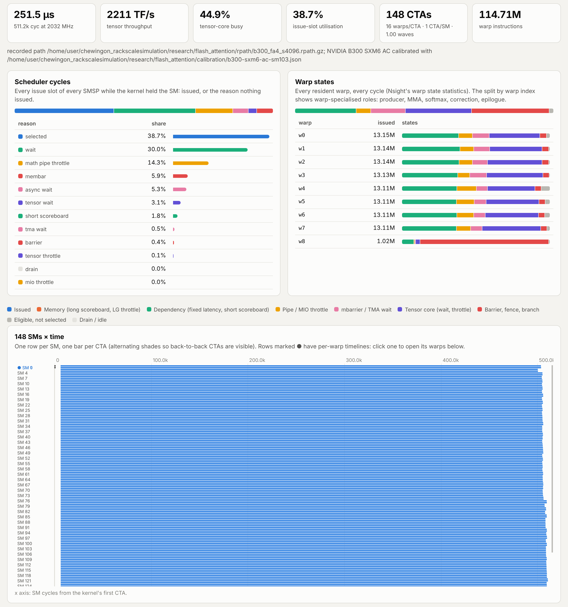

# Visualising a simulation: rack to SASS

`rsim viz` runs a simulation with full capture and writes one self-contained HTML page. The page
zooms through five levels, each drawn from what the simulator actually executed:

| level | what you see | answers |
|---|---|---|
| **Rack** | NVLink/NVSwitch fabric with per-GPU busy time and per-link utilisation (with a time slider); every stream of every GPU on one timeline; the rack's bubble anatomy; collectives; a kernel table with stall anatomy per kernel | Where do the step's microseconds go? Which GPU or collective is on the critical path? |
| **GPU** | streams, and all of the GPU's SMs as rows with one bar per CTA | Wave quantisation, idle SMs, tails, SMs held by communication kernels |
| **Kernel** | scheduler-cycle and warp-state anatomy, split by warp role (producer, MMA, softmax, correction, epilogue); per-SM CTA timeline; mbarrier handoffs; instruction mix; L1/L2/DRAM | Is it tensor-bound, memory-bound, or waiting on a handoff? |
| **SM / warps** | every warp of a traced SM, every cycle: state as colour (issued, memory, dependency, pipe throttle, mbarrier/TMA wait, tensor-core wait, barrier), issued instructions as ticks | Which warp is the bubble, and when? Zoom down to single cycles. |
| **SASS** | every instruction with its issue count and stall samples by reason, like Nsight Compute's source view; tcgen05 (`UTC*MMA`), TMA, mbarrier (`SYNCS`), MUFU and TMEM ops tagged | Which instruction does the time go to? Click one to mark its issues in the warp timeline. |

Open a page in any current browser; it needs no server and no network. The bundle is embedded
gzip-compressed and inflated by the browser.



## Commands

```bash
cargo build --release -p rsim-cli

# A rack run (any workload `rsim run` accepts). Detail (SMs, warps, SASS) for the listed ranks.
rsim viz run --system configs/gb200_nvl72.yaml --workload wl.json --fast \
    --detail-ranks 0 --warp-sms 0,1 -o ds.html

# A kernel recorded on hardware with NVBit (research/flash_attention), replayed on a calibrated B300
rsim viz path fa4.rpath --gpu b300 --calibration research/flash_attention/calibration/b300-sxm6-ac-sm103.json \
    --regs 128 --warp-sms 0,1 -o fa4.html

# A synthetic kernel, or a cuobjdump/nvdisasm listing
rsim viz kernel --gpu b200 attention 1 16 16 4096 4096 128 1 -o attn.html
rsim viz sass kernel.sass --gpu h100_sxm --grid 528 --block 256 -o k.html

# Several runs in one page, with a side-by-side comparison (inputs: .json bundles or pages)
rsim viz merge fa2.html fa4.html --title "FA2 vs FA4" -o fa.html
```

`--note "..."` attaches an explanation that the page shows as a "Reading this run" card (blank
lines separate paragraphs). `-o x.json` writes the bundle instead of a page. The bare viewer, `viz/viewer.html`, opens a
bundle by drag-and-drop (`.json` or `.json.gz`) or from `?src=<url>`.

From Python:

```python
import rackscale as rs
from rackscale import lower, models
wl = lower.decode_step(models.DEEPSEEK_V3, rs.Parallel(ep=72, comm_sms=20), 64, 4096, layers=4)
rs.viz("gb200_nvl72", wl, "ds.html", detail_ranks=[0], warp_sms=[0])
```

The example pages in [`docs/viz/`](viz/) are rebuilt with `python examples/viz_gallery.py` (about 25 minutes, most of it the two FlashAttention replays; `python examples/viz_gallery.py deepseek` builds one page):

| page | run |
|---|---|
| [`deepseek_v3_nvl72.html`](viz/deepseek_v3_nvl72.html) | DeepSeek-V3 decode, 4 layers, EP72 on GB200 NVL72, batch 64 per GPU, 4k context; single stream vs two-micro-batch overlap |
| [`mamba_vs_attention_b300.html`](viz/mamba_vs_attention_b300.html) | Llama-3-8B vs Mamba-2-8B decode (2 layers, batch 64, 16k context) on a calibrated B300, plus the attention decode kernel alone. Mamba-2's `selective_state_update` runs the real Triton SASS. |
| [`flash_attention_b300.html`](viz/flash_attention_b300.html) | FlashAttention-2 vs FlashAttention-4 forward (b4 h16 s4096 d128) replayed from NVBit recordings of the real kernels on a calibrated B300 |

## What is captured, and what it costs

Capture lives in `rsim_gpu::detail` and is off unless asked for (`GpuConfig::detail`). Off, it
costs one branch per scheduler step. On, a kernel simulates about 1.5-2x slower.

* **CTA residency**: SM, CTA id, start and end cycle of every CTA.
* **Per-PC statistics**: issue count per instruction, and the warp-state samples of every warp
  waiting to issue it. A stalled warp's cycle is charged to the instruction it is waiting to
  issue, which is how Nsight Compute's warp stall sampling attributes it, except that the
  simulator counts every cycle rather than sampling. Keys are `role << 32 | pc`: synthetic
  kernels give each warp role its own program; recorded kernels share one binary (role 0).
* **Warp timelines** (`--warp-sms`): run-length state segments and the PC of every issued
  instruction, for every warp on the chosen SMs. `--max-warp-events` caps the events per SM
  (default 400k); a capped timeline ends early and says so.
* **Link utilisation**: busy time of every link direction per `--link-bin-ns` bin (default 1 µs).

Captured data is attached to each finished kernel with cycles relative to the kernel's start.
In fast mode one capture serves every launch of the same kernel. Timelines do not include the
DVFS stretch that `dvfs_stretch` applies to a power-capped kernel's span.

## Reading the colours

Stall reasons are Nsight's warp states, grouped into families so the colours stay distinguishable:

| family | states |
|---|---|
| Issued | `selected` |
| Memory | `long_scoreboard`, `lg_throttle` |
| Dependency | `wait` (fixed latency / control-bit stall), `short_scoreboard` |
| Pipe / MIO throttle | `math_pipe_throttle`, `mio_throttle` |
| mbarrier / TMA wait | `async_wait`, `tma_wait` |
| Tensor core | `tensor_wait`, `tensor_throttle` |
| Barrier, fence, branch | `barrier`, `membar`, `branch_resolving` |
| Eligible, not selected | `not_selected` |
| Drain / idle | `drain`, `idle` |

Every table and tooltip names the exact state. Two views count different things. **Scheduler
cycles** count issue slots: each SMSP cycle is either an issue or is charged to the warp that
unblocks first. **Warp states** count every resident warp every cycle. A kernel with 38% issue
utilisation can still show most warps waiting most of the time.

## Bundle format (`rsviz/1`)

```text
{format: "rsviz/1", title, generator, runs: [run]}
run = {
  kind: "rack" | "kernel", name, workload, makespan_us, mfu?, gpu_idle?, tensor_idle?,
  sched: {state: fraction},                       // rack-wide scheduler anatomy
  stalls: [state names],                          // index order of every stall array
  strings: [..],                                  // string table
  system: {name, gpus: [{name, arch, sm_count, smsp, clock_mhz, bf16_tflops, hbm_gbps, ...}],
           rank_gpu: [gpu index per rank], nodes: [{t: "gpu", rank} | {t: "switch", label, name, ports}],
           links: [[a, b, count, gbps_per_dir, latency_ns]]},
  ranks: [{rank, finish_us, busy_us,
           spans: flat [stream, kind (0 kernel, 1 collective, 2 fixed, 3 delay), label (string id),
                        start_ns, end_ns, kernel index or -1]}],
  kernels: [{name (string id), rank, start (cycles), cycles, ctas, warps, ctas_per_sm, insts,
             tensor_util, issue_util, tflops, dram_bytes, sched: [stall counts], d: detail index or -1}],
  details: [{roles: [names], ctas: flat [sm, cta, start, end],
             warps: [{sm, truncated, warps: [{slot, smsp, cta, widx, role?, start, end,
                                             seg: flat [state, start, end], iss: flat [cycle, pc]}]}],
             pc: [[role << 32 | pc, text (string id), class (string id), issued, [stall counts]]],
             warp: [stall counts], warp_by_index: [[stall counts]], issued_by_index, mbar_wait: {"w<i>:<bar>": cycles},
             class_mix, l1_hits, l1_misses, l2_hits, l2_misses, smem_wavefronts}],
  link_use: [[from node, to node, bytes, busy fraction]], link_bin_ns, node_bins: [[busy fraction per bin]],
  collectives: [CollRecord], note?
}
```

Cycles in `details` are SM cycles relative to the kernel's `start`; times in `spans` are ns.
Detail is deduplicated: kernels with the same capture share one `details` entry.
