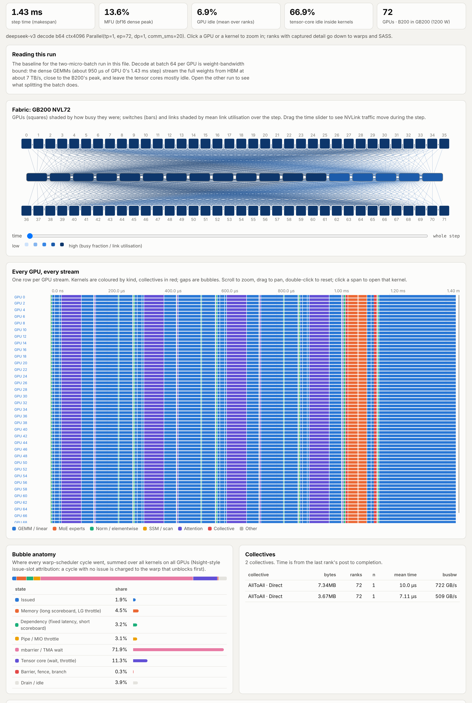

# 6. Inference: prefill, decode, MoE, and state-space models

Serving a language model has two phases with opposite characters. **Prefill** processes the
prompt: thousands of tokens per sequence go through every weight at once, so its GEMMs have
large *M* and are compute bound. **Decode** generates one token per sequence per step: *M* is
the batch, the GEMMs fall far below the ridge of chapter 1, and the step is a race to stream
the weights and the KV cache out of HBM. This chapter works out both from first principles,
then checks them against measured kernels and simulated racks.

## 6.1 The KV cache

Attention needs every previous token's keys and values. Per token, a model stores

```
KV bytes per token = 2 (K and V) · L · H_kv · d · b
```

| model | *L* | *H*<sub>kv</sub> × *d* | KV per token (BF16) | at 4k context | at 128k |
|---|---|---|---|---|---|
| Llama-3-8B | 32 | 8 × 128 | 128 KB | 0.5 GB | 16 GB |
| Llama-3-70B | 80 | 8 × 128 | 320 KB | 1.3 GB | 43 GB |
| DeepSeek-V3 (MLA) | 61 | one 576-wide latent | 70 KB | 0.29 GB | 9.2 GB |
| Mamba-2 8B (no KV) | 64 | fixed state, 2 MB per layer | 0 per token; 128 MB per sequence | 128 MB | 128 MB |

Grouped-query attention (8 KV heads instead of 64) cut the cache 8×; DeepSeek's multi-head
latent attention (MLA) stores one compressed latent per token per layer instead of per-head
K and V and cuts it again. State-space models replace the cache with a fixed-size recurrent
state.

## 6.2 Decode is weight streaming

A decode step at batch *B* and context *S* reads every weight once and every sequence's KV
cache once. With the weight-stationary GEMM of chapter 1 (*I* ≈ *B*), as long as *B* is below
the critical batch (361 on B300, 180 on A100):

```
T_decode ≈ (P_bytes + B · S · KV_per_token) / β       (per GPU, for its shard)
tokens/s = B / T_decode
```

Two consequences:

1. **Throughput grows almost linearly with batch** until the KV cache term dominates or the
   GEMMs reach the ridge. Latency per token barely changes.
2. **Bytes, not FLOPs, set the cost.** Halving weight precision halves the weight term; FP4
   weights decode nearly twice as fast as BF16 even though the tensor core is idle either way.

Measured on B300 (one layer of the Llama-3-8B shape, batch 64, CUDA graphs, from the Mamba
study): the four projection GEMMs take 9.4 to 43 µs and stream weights at 3.7 to 5.6 TB/s. The
decode attention (FA4) reads the KV cache at **6.9 TB/s**, 90% of the HBM peak, once the cache
is large enough to fill the GPU.

## 6.3 DeepSeek-V3 on NVL72

The DeepSeek inference layout: expert parallelism over all 72 GPUs, attention data parallel
(every GPU owns its own 64 sequences), MLA decode attention, BF16 weights, 4k context. We
simulate the first four layers (the three dense layers and the first MoE layer) plus the LM
head:

```bash
python examples/deepseek_v3_nvl72.py --layers 4      # fast mode, both schedules
```

| schedule | step | MFU | GPU idle |
|---|---|---|---|
| single stream | **1435 µs** | 13.6% | 6.9% |
| two-micro-batch overlap | 2372 µs | 8.2% | 0.9% |

Per GPU, the biggest kernels of the single-stream step (simulator totals divided by 72 ranks):

| kernel | per GPU | throughput | what bounds it |
|---|---|---|---|
| MLA decode attention, 4 layers (128 heads over one 576-wide latent) | 278 µs | 1.11 PFLOP/s, 4.9 TB/s | near the ridge: all 128 heads reuse each latent |
| LM head, 64 × 129280 × 7168 | 272 µs | 7.1 TB/s | weight streaming at 89% of 8 TB/s |
| dense MLP gate+up, 3 layers | 235 µs | 7.0 TB/s | weight streaming |
| dense MLP down + attention output projections | 308 µs | 6.1 TB/s | weight streaming, split-K |
| MoE expert grouped GEMMs | 61 µs | | 3 local experts, about 170 tokens each |
| all-to-all dispatch + combine (one MoE layer) | about 10 µs each | 509 and 722 GB/s busbw | NVLink5 |

Everything follows from the first two sections. The GEMMs stream weights near the HBM roof
with *M* = 64, half the 128-row UMMA tile (tensor-core utilisation about 35%). The one kernel
that is not memory bound is MLA attention: 128 query heads share one latent, so each 1152-byte
latent feeds 128 × (2 × 576 + 2 × 512) ≈ 279 k FLOP, about 240 FLOP per byte. That is close to
GB200's ridge (2.5 PFLOP/s / 8 TB/s ≈ 310), and the kernel runs at 1.1 PFLOP/s and 4.9 TB/s,
at neither roof; it is the largest single kernel of the step. The bubbles that
cost time are the ~14% `tma_wait` (tensor core starved by loads) and the 6.9% of the step the
GPU sits idle between kernels.

Fast mode (each distinct kernel simulated once, cycle level, then reused across ranks and
layers; the fabric and all dependencies still exact) is within 1% of a full co-simulation of
all 72 GPUs on this workload: 1729 vs 1712 µs at batch 32, 12 s against 6.5 minutes.



*Rack level, single-stream schedule: the NVL72 fabric, every GPU's streams, and the bubble
anatomy, where 72% of scheduler cycles are mbarrier or TMA waits. One GPU opened up
([`viz_ds_gpu.png`](../img/viz_ds_gpu.png)) shows its streams and one bar per CTA on all 148
SMs. Interactive version: [`docs/viz/deepseek_v3_nvl72.html`](../viz/deepseek_v3_nvl72.html).*

## 6.4 Two-micro-batch overlap, and when it pays

DeepSeek runs two micro-batches per step on separate streams, so one micro-batch's
all-to-all overlaps the other's compute. The simulator models exactly that
(`lower.decode_step(..., overlap=True)`).

On NVL72 at batch 64 it loses: the step goes from 1435 to 2372 µs. Each half-batch reads all
the weights again, and a weight-bound GEMM at half the batch costs almost the same as at the
full batch (section 6.2), so the GEMM time nearly doubles. What it hides, about 10 µs of
all-to-all per MoE layer, is small on NVLink5.

Overlap pays when the communication it hides is comparable to the compute: over InfiniBand
(the 175 µs dispatch of chapter 4), at larger EP degrees across racks, or when the weights are
small enough (FP8 or FP4) that doubling the weight reads is cheap. The production setting it
was designed for, H800 nodes connected by InfiniBand, is the first case.

## 6.5 FP4 weights on GB200 and GB300

Same layout, first four layers, fast mode
([`examples/gb300_deepseek_fp4.py`](../../examples/gb300_deepseek_fp4.py)); batch is per GPU.
GB300 uses the measured B300 calibration; GB200 is a preset:

| system | batch | weights | step | GEMM time per GPU | tokens/s per GPU |
|---|---|---|---|---|---|
| GB200 NVL72 | 64 | BF16 | 1435 µs | 1016 µs | 44.6k |
| GB200 NVL72 | 64 | FP4 | 783 µs | 364 µs | 81.7k |
| GB300 NVL72 | 64 | BF16 | 1432 µs | 1024 µs | 44.7k |
| GB300 NVL72 | 64 | FP4 | 779 µs | 371 µs | 82.1k |
| GB300 NVL72 | 256 | BF16 | 2461 µs | 1329 µs | 104.0k |
| GB300 NVL72 | 256 | FP4 | 1663 µs | 526 µs | 154.0k |

- **FP4 nearly doubles decode throughput** (1.8× at batch 64, 1.5× at 256). The GEMM time drops
  about 2.8×, close to the 4× fewer weight bytes minus fixed costs.
- **GB300 is no faster than GB200 at decode.** Both have 8 TB/s-class HBM, decode never uses
  the extra FP4 FLOPs, and memory-bound GEMMs stay well under the 1100 W cap.
- **At batch 256 the GEMMs are under a third of the step.** MLA attention, the all-to-alls and
  the norms set the pace, so the next lever is attention (an FP8 KV cache, FlashMLA-style
  kernels), not lower-precision weights.

## 6.6 Prefill is compute

Prefill at *T* tokens per sequence runs the same GEMMs at *M* = *T*, far above the ridge, plus
attention whose FLOPs grow with *T*². Time to first token is

```
TTFT ≈ (2 · P_active · T + 4 · L · H · d · T² / 2) / (N · π_eff)       (causal: half the T² term)
```

For Llama-3-405B prefill at 8k tokens, TP8 × 9 replicas on NVL72, first two layers
([`examples/gb300_fp4.py`](../../examples/gb300_fp4.py)):

| system | weights | step | GEMM time per GPU |
|---|---|---|---|
| GB200 NVL72 | BF16 | 11825 µs | 8844 µs |
| GB200 NVL72 | FP4 | 5370 µs | 2388 µs |
| GB300 NVL72 | BF16 | 9477 µs | 6668 µs |
| GB300 NVL72 | FP4 | 5541 µs | 2420 µs |

Here GB300's FP4 GEMMs are no faster than GB200's. Large FP4 GEMMs hit the 1100 W cap and the
clock falls to 1.6 to 1.9 GHz (chapter 1.6), which cancels GB300's FP4 advantage. GB200 has no
measured power data, so the simulator runs it unthrottled; that favours GB200, and measured
GB200 power runs would make the comparison fair. GB300's BF16 advantage (−20%) comes from its
measured memory system and from the higher clock on kernels that are not power bound.

## 6.7 Where Mamba-2 beats attention

A Mamba-2 layer at decode reads and writes a fixed state (2 MB per sequence per layer in BF16
for the 8B configuration: 128 heads × 64 × 128). Attention reads a KV cache that grows with
context. On paper the state wins once the KV cache is larger than the state read plus the state
written: 4 MB against 4 KB of K and V per token per layer, so about 1k tokens. On hardware, measured with CUDA graphs and a cold L2 on
each GPU ([`research/ssm_vs_attention/`](../../research/ssm_vs_attention/README.md)):

| | A100 | B300 |
|---|---|---|
| decode crossover: context where one attention layer costs more than one Mamba-2 layer, batch 32 to 256 | **~1.1k tokens** | **~3.4k tokens** |
| prefill crossover: prompt length where FlashAttention costs more than the SSD scan | **~4.2k tokens** | **~10.9k tokens** |
| `selective_state_update` state bandwidth | 1.0 TB/s (55% of HBM) | 2.0 TB/s (26% of HBM) |
| FlashAttention KV-cache bandwidth | 1.3 TB/s | 6.9 TB/s |

Blackwell pushed both crossovers about 3× further out. The reason is in the SASS. The Triton
state-update kernel moves only 2 KB of state per CTA (its tuned `BLOCK_SIZE_M = 4`), runs about
270 instructions per warp of mostly address arithmetic, an integer division and five
`BAR.SYNC`, and Nsight reports it as issue bound (`not_selected`, `math_pipe_throttle`) with
the DRAM pipe at 11 to 25%. On A100 the same instruction count is a smaller multiple of the time
HBM needs, so the kernel looks bandwidth bound there. FA4, meanwhile, rides the new tensor
cores and TMA. For prefill, causal FA at 16k tokens got 7.8× faster from A100 to B300, while
the SSD scan got 3.1× faster: none of its five Triton kernels is a big dense GEMM.

**At rack scale** (simulated, 70B-class models, TP8 on GB200 NVL72, best batch that fits in
HBM): the Transformer decodes 3637 tokens/s per GPU at 1k context, 1.4× the hybrid and 3.0×
pure Mamba-2. From 16k context the hybrid (24 Mamba-2, 4 attention, 28 MLP blocks per 8B
layout) wins, 2006 vs 700 tokens/s per GPU, because its KV cache is a ninth of the
Transformer's and it keeps batch 512 in HBM. Pure Mamba-2 is flat at 1196 tokens/s per GPU at
every context; a state-update kernel with 8 rows per CTA instead of 4 would lift it to about
2310 (1.9×), an upper bound since the simulator streams that kernel slightly faster than the
B300's measured copy bandwidth.

## Exercises

1. How large a batch of Llama-3-70B sequences at 32k context fits in one GB200's 186 GB next to
   a TP8 weight shard (70.6 B parameters / 8 in BF16)?
2. For DeepSeek-V3 at 4k context and batch 64 per GPU, compare the KV-cache bytes an MLA decode
   step reads per GPU with the weight bytes (per GPU, 4 layers + LM head ≈ 6 GB in BF16).
3. A decode step on B300 is 80% weight streaming at batch 32. Roughly what throughput gain do
   you expect from batch 64? From FP8 weights at batch 32?
4. Why does FP4 help decode on GB300 but not prefill?

<details><summary>Answers</summary>

1. Weights: 70.6 × 10<sup>9</sup> × 2 / 8 = 17.7 GB. KV per token per GPU: 320 KB / 8 = 40 KB, so
   32k tokens = 1.3 GB per sequence. (186 × 0.9 − 17.7) / 1.3 ≈ **115 sequences**.
2. KV: 64 × 4096 × 576 × 2 B × 4 layers ≈ **1.2 GB**, a quarter of the weight bytes. Over all
   61 layers the KV read (18 GB) is several times the per-GPU weights, because EP spreads the
   experts while every GPU keeps its own sequences' caches.
3. Batch 64: the weight term is shared, so throughput nearly doubles (time grows only by the KV
   and per-token work, about 20%): about **1.7×**. FP8 weights at batch 32: the 80% weight term
   halves, so time drops to 60%: about **1.7×**.
4. Decode GEMMs are bound by weight bytes, which FP4 cuts 4×. Prefill GEMMs are compute bound,
   and on GB300 large FP4 GEMMs hit the power cap, so the extra FP4 FLOPs do not arrive.

</details>

## Reproduce

| number | command |
|---|---|
| DeepSeek-V3 decode on NVL72, both schedules | `python examples/deepseek_v3_nvl72.py --layers 4` |
| the viewer figures (interactive: `docs/viz/deepseek_v3_nvl72.html`, `docs/viz/mamba_vs_attention_b300.html`) | `python examples/viz_gallery.py deepseek` / `mamba` |
| FP4 decode table | `python examples/gb300_deepseek_fp4.py` |
| FP4 prefill table | `python examples/gb300_fp4.py` |
| Mamba vs attention, single GPU (measured) | `research/ssm_vs_attention/results/summary.json` |
| Mamba vs attention, simulator validation | `python research/ssm_vs_attention/validate.py --gpu b300` |
| rack sweeps | `python research/ssm_vs_attention/sweep.py --family 70b --full-rack` |
| any decode | `rackscale decode llama3-70b --system hgx_b200_8 --tp 8 --batch 32 --layers 2 --fast` |

Next: [7. Training](07-training.md).
