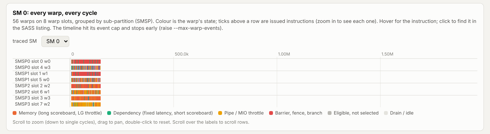

# Examples gallery

Everything here runs from a clone with `pip install .` (or `maturin develop --release`), on a
CPU. Times are wall-clock on a 4-core machine.

## Run reports

One page per run, or several runs side by side: where the GPU time goes, every kernel on the
roofline, what the warp schedulers wait on, the collectives, and each figure as a standalone SVG
that drops into an article or a slide (light and dark aware). Hover any mark for its numbers.

<div class="grid cards" markdown>

-   **[DeepSeek-V3 decode on NVL72: GB200 vs GB300, BF16 vs FP4](reports/deepseek_v3_nvl72.html)**

    ---

    EP72, batch 64 per GPU, 4k context. GB300 alone is 2% slower than GB200 at its lower clock;
    FP4 GEMMs cut the step 1.7x because decode GEMMs stream weights, not because of the FP4 peak.

    

-   **[Llama-3-70B decode, TP8: H100, B200, B300](reports/llama3_70b_generations.html)**

    ---

    Same workload on three generations; the roofline shows which kernels move with HBM bandwidth
    and which stay latency bound.

    

-   **[Llama-3-70B training step, TP8: H100 vs B200](reports/llama3_70b_train.html)**

    ---

    Forward and backward of 2 layers at 4k: training GEMMs sit on the compute roof.

    

</div>

Make your own from any simulate command, or from saved JSON reports:

```bash
rackscale decode deepseek-v3 --system gb200_nvl72,gb300_nvl72 --ep 72 --batch 64 --layers 4 --fast \
    --html ds.html --figures ds_figs/ --open
rackscale report a.json b.json -o compare.html           # any saved --report files
```

Rebuild these three with `python examples/report_gallery.py` (about a minute).

## Viewer pages

Open one, click a GPU, then a kernel, then an SM. Each is a single self-contained HTML file.

<div class="grid cards" markdown>

-   **[DeepSeek-V3 decode on GB200 NVL72](viz/deepseek_v3_nvl72.html)**

    ---

    4 layers, EP72, batch 64 per GPU, 4k context. Single stream vs DeepSeek's two-micro-batch
    overlap, side by side: the NVLink fabric, all 72 GPUs' streams, and the all-to-all.

    

-   **[FlashAttention-2 vs FlashAttention-4 on B300](viz/flash_attention_b300.html)**

    ---

    Both forward kernels replayed from NVBit recordings of the real kernels on a calibrated B300:
    warp roles, mbarrier handoffs, every warp of an SM cycle by cycle.

    

-   **[Mamba-2 vs attention on B300](viz/mamba_vs_attention_b300.html)**

    ---

    Llama-3-8B vs Mamba-2-8B decode at 16k context. Mamba-2's `selective_state_update` runs the
    real Triton SASS.

    

</div>

Rebuild them with `python examples/viz_gallery.py` (about 25 minutes, most of it the two
FlashAttention replays), or one page with `python examples/viz_gallery.py deepseek`.

## Scripts

| script | what it shows | time |
|---|---|---|
| `rackscale demo` | Llama-3-70B decode on HGX H100 vs B200, the anatomy, a run report and a viewer page | 3 s |
| [`report_gallery.py`](https://github.com/AbiralShakya/ChewingOn_RackScaleSimulation/blob/main/examples/report_gallery.py) | the run reports above and their SVG figures | 1 min |
| [`deepseek_v3_nvl72.py`](https://github.com/AbiralShakya/ChewingOn_RackScaleSimulation/blob/main/examples/deepseek_v3_nvl72.py) | DeepSeek-V3 decode on NVL72 (EP72), single stream vs two-micro-batch overlap | 9 s |
| [`async_rl_mixed.py`](https://github.com/AbiralShakya/ChewingOn_RackScaleSimulation/blob/main/examples/async_rl_mixed.py) | asynchronous RL: 8 H100 samplers decode while 8 B200 trainers train, then push weights over InfiniBand | 11 s |
| [`gb300_deepseek_fp4.py`](https://github.com/AbiralShakya/ChewingOn_RackScaleSimulation/blob/main/examples/gb300_deepseek_fp4.py) | GB200 vs GB300 NVL72, DeepSeek-V3 decode with BF16 vs FP4 weights | 1 min |
| [`gb300_fp4.py`](https://github.com/AbiralShakya/ChewingOn_RackScaleSimulation/blob/main/examples/gb300_fp4.py) | GB200 vs GB300 NVL72, Llama-3-405B prefill in BF16 and FP4, and why the power cap eats FP4's 1.5x | minutes |
| [`gb300_whatifs.py`](https://github.com/AbiralShakya/ChewingOn_RackScaleSimulation/blob/main/examples/gb300_whatifs.py) | one-number what-ifs on a calibrated B300: 2x MUFU, 2x shared memory, no power cap | minutes |
| [`agent/perf_agent.py`](https://github.com/AbiralShakya/ChewingOn_RackScaleSimulation/blob/main/examples/agent/perf_agent.py) | an agent loop that finds bottlenecks and keeps only changes that beat the error band | 1 min |
| [`capture/`](https://github.com/AbiralShakya/ChewingOn_RackScaleSimulation/tree/main/examples/capture) | capture vLLM and SGLang on one GPU, validate the replay, scale one TP rank to a rack (needs a GPU to capture) | |
| [`sass/vecadd_sm90.sass`](https://github.com/AbiralShakya/ChewingOn_RackScaleSimulation/blob/main/examples/sass/vecadd_sm90.sass) | a `cuobjdump` listing to try `rackscale sass` on | <1 s |

The guide's chapters each end with the commands and scripts that reproduce their numbers
([`docs/book/scripts/`](https://github.com/AbiralShakya/ChewingOn_RackScaleSimulation/tree/main/docs/book/scripts)),
and the research studies live in
[`research/`](https://github.com/AbiralShakya/ChewingOn_RackScaleSimulation/tree/main/research).

## Sample output

`python examples/gb300_deepseek_fp4.py`: decode is weight-bandwidth bound, so FP4 weights help
through bytes, not FLOPs.

```
system       batch dtype   step us  GEMM us/GPU  tok/s/GPU
gb200_nvl72     64 bf16     1556.5        996.9      41117
gb200_nvl72     64 fp4       916.9        357.3      69801
gb300_nvl72     64 bf16     1595.6       1003.7      40111
gb300_nvl72     64 fp4       940.2        349.1      68071
gb200_nvl72    256 bf16     3010.4       1347.3      85037
gb200_nvl72    256 fp4      2143.2        480.1     119448
gb300_nvl72    256 bf16     3110.5       1221.1      82303
gb300_nvl72    256 fp4      2222.0        430.5     115213
```
